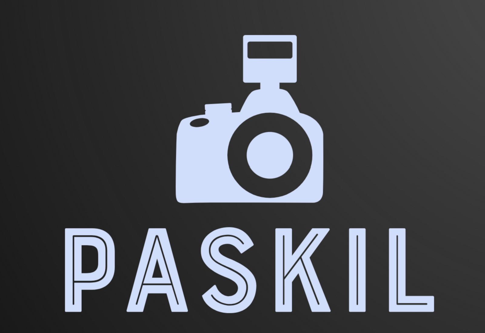

# Photo Editor App (Paskil Addition)

A desktop image editor built from scratch in **Java Swing**, with every filter and
transformation implemented at the pixel level — no image-processing libraries.

Submitted as a group assignment for **Fundamentals of Programming (FOP), Semester 1**.



---

## About

The app loads an image, lets you apply effects either to the **whole image** or to a
**selected region**, and supports a save / undo / revert history so you can experiment
freely. All image maths — blur kernels, Sobel edge detection, sepia and grayscale
conversion — is written by hand using `BufferedImage.getRGB()` / `setRGB()` and bit
manipulation of ARGB values.

**Stack:** Java 17 · Swing / AWT · `javax.imageio` · no third-party dependencies

---

## Features

### File
| Action | Description |
| --- | --- |
| **Import** | Open a `.jpg` or `.png` through a file chooser; invalid files are rejected with an error dialog |
| **Export** | Write the edited image back to disk |

### Global effects
| Effect | How it works |
| --- | --- |
| **Brightness Adjustment** | Live slider (scale factor `0.0`–`5.0`) multiplying each RGB channel, clamped to 0–255 |
| **Blur** | Live slider driving a box-blur convolution; kernel size = `5 × intensity`, forced odd |
| **Monochrome** | Luminance weighting `0.3R + 0.59G + 0.11B` |
| **Sepia** | Classic sepia colour matrix |
| **Invert** | `255 − channel` per channel |
| **Edge Detection** | Sobel operators on a grayscale copy, gradient magnitude `√(Gx² + Gy²)` |
| **Cyberpunk** | Channel scaling (R ×1.2, G ×1.0, B ×1.5) for a neon colour cast |

### Selective effects (`Bound` menu)
Click anywhere on the image to apply an effect inside a **70 × 50 bounding box** at that
point. Available for Brightness, Blur, Monochrome, Sepia, Inversion, Edge Detection and
Cyberpunk — each one reuses the same pixel maths as its global counterpart, restricted to
the selected rectangle.

### Tools & transforms
| Tool | Description |
| --- | --- |
| **Draw** | Freehand black-line drawing with the mouse, painted directly onto the image |
| **Zoom In / Zoom Out** | Rescales the view by ±100 px in both dimensions |
| **Crop** | Prompts for width and height, crops from the top-left origin |
| **Resize** | Prompts for new width and height and rescales via `Graphics2D` |

### History
| Action | Description |
| --- | --- |
| **Save** | Commits the current edit as a snapshot onto the history list |
| **Undo** | Steps back to the previous saved snapshot |
| **Revert** | Restores the originally imported image |

---

## Project structure

```
Photo_Editor-App/
├── PhotoEditor.java     # Entire application (~1,085 lines, package photoEditor)
├── PhotoEditor.rar      # Complete NetBeans Ant project (src + nbproject + build)
├── paskil.png           # Window icon / app mascot
└── README.md
```

### Code layout inside `PhotoEditor.java`

`PhotoEditor extends JFrame` holds all shared state and UI:

- **State:** `originalImage` (pristine import), `editedImage` (working copy),
  `zoomImage` (zoom source), `adjustedImages` (`ArrayList<BufferedImage>` history stack)
- **UI builders:** `createMenuBar()`, `buttonAlignment()`, `addCenterAlignedButton()` —
  menu bar on top, button column docked `EAST`, image in `CENTER`
- **Effect methods:** `adjustBrightnessEffect()`, `blurEffect()`, `monochromeFilter()`,
  `SepiaFilter()`, `InversionFilter()`, `EdgeDetectFilter()`, `CyberpunkFilter()`,
  `cropImageEffect()`, `resizeImageEffect()`, `zoomImageEffect()`
- **History:** `saveEffect()`, `saveImage()`, `undoEffect()`, `undoImage()`,
  `revertImage()`, `copyImage()` (deep copy via `ColorModel` + `WritableRaster`)
- **Inner classes:** `draw` plus seven `Selective*Effect` classes, each installing its own
  `JPanel` with a `MouseAdapter` for region-based editing

Entry point runs the frame on the Swing event dispatch thread:

```java
public static void main(String[] args) {
    SwingUtilities.invokeLater(() -> new PhotoEditor());
}
```

---

## Running the app

**Requirements:** JDK 17 or newer.

### Option 1 — command line

The class declares `package photoEditor;`, so it must sit in a matching folder:

```bash
mkdir photoEditor
cp PhotoEditor.java photoEditor/
javac photoEditor/PhotoEditor.java
java photoEditor.PhotoEditor
```

Run from the folder containing `paskil.png` so the window icon loads.

### Option 2 — NetBeans

Extract `PhotoEditor.rar`, then **File → Open Project** and point NetBeans at the
`PhotoEditor` folder. It is a standard Ant-based Java application:

- Main class: `photoEditor.PhotoEditor`
- Source / target: Java 17
- Source encoding: UTF-8

Press **Run** (F6), or build from the command line with `ant run`.

---

## How to use

1. **File → Import** and pick a JPG or PNG.
2. Apply effects from the right-hand buttons, the **Filters** menu, or the **Bound** menu
   for region edits.
3. Click **Save** to commit a result you like — this is what **Undo** steps back through.
4. **Revert** returns to the original import at any point.
5. **File → Export** writes the finished image to disk.

> **Tip:** The brightness and blur sliders recompute from the last *saved* snapshot every
> time you move them, so you can preview freely without stacking the effect. Hit **Save**
> once you're happy.

---

## Known limitations

Honest notes on current behaviour, useful as a starting point for future work:

- **Export format** — `ImageIO.write(..., "jpg", ...)` is hardcoded, so output is always
  JPEG regardless of the filename you type, and no extension is appended automatically.
- **Selective effects near edges** — the 70 × 50 bounding box isn't clipped to the image,
  so clicking close to the right or bottom edge throws an out-of-bounds exception.
- **Crop anchor** — cropping is fixed to the top-left `(0, 0)` origin; it takes width and
  height only, not an arbitrary rectangle.
- **Filters vs. history** — menu filters mutate `editedImage` in place and are only
  captured by **Undo** after a **Save**.
- **Alpha channel** — most filters rebuild the pixel without the alpha bits, so
  transparency in PNGs is not preserved.
- **Blur performance** — the box blur is a naive four-nested-loop convolution, so large
  kernels on large images are noticeably slow.
- **Zoom** — scales from the `zoomImage` snapshot by a fixed ±100 px step rather than a
  true zoom factor, and does not recentre the view.
- **No tests** — the NetBeans `test` folder is empty.

---

## Possible improvements

- Honour the chosen file extension on export (PNG / JPEG / BMP)
- Clamp selective-effect rectangles to the image bounds
- Drag-to-select an arbitrary region instead of a fixed box
- Separable Gaussian blur for better quality and speed
- Colour picker and brush size for the draw tool
- Redo stack alongside undo
- Split the single 1,085-line file into `ui/`, `filters/` and `history/` packages

---

## Course context

Built for the **Fundamentals of Programming** module, demonstrating:

- Object-oriented design — inheritance (`extends JFrame`), inner classes, encapsulation
- Event-driven programming — listeners, lambdas, anonymous classes, the Swing EDT
- 2D arrays and convolution kernels for image filtering
- Bitwise operations for packing and unpacking ARGB pixel values
- Collections (`ArrayList`) for an undo history
- File I/O and exception handling with user-facing error dialogs

---

## Authors

Group project for FOP Semester 1 — [@Nazeem777](https://github.com/Nazeem777) and team.

## License

Coursework project, shared for educational and portfolio purposes.
